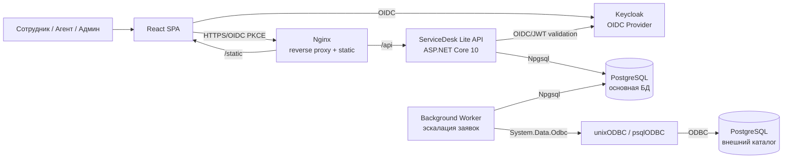

# Архитектурный контекст

ServiceDesk Lite — портал заявок на ИТ-оборудование. Система обслуживает
сотрудников (создание заявок), агентов (обработка) и администраторов
(справочники, отчёты). Аутентификация — через Keycloak (OIDC), данные —
в PostgreSQL, справочник сотрудников синхронизируется из внешней БД через
unixODBC.

## C4 — System Context

## Основные компоненты

| Компонент | Ответственность |
|---|---|
| **React SPA** | UI, OIDC-логин через Keycloak, роли, работа с API |
| **Nginx** | TLS-терминация, reverse proxy `/api`, раздача статики |
| **ServiceDesk Lite API** | Бизнес-логика, CRUD, работа с БД через Npgsql, JWT-аутентификация |
| **Background Worker** | Эскалация просроченных заявок, синхронизация справочника сотрудников |
| **Keycloak** | SSO, JWT-выпуск, роли |
| **PostgreSQL (основная)** | Домен, аудит, агрегаты для отчётов |
| **PostgreSQL (внешняя)** | Эмуляция внешнего каталога сотрудников, доступ — через ODBC |

## Потоки данных (кратко)

1. **Логин.** SPA → Keycloak (PKCE) → access token → API (Bearer).
2. **Заявки.** SPA → API → PL/pgSQL-функции → Postgres.
3. **Синхронизация.** Worker → ODBC → внешний каталог → UPSERT в `employees`.
4. **Отчёты.** SPA → API → materialized view + PL/pgSQL агрегаты → PDF/CSV.